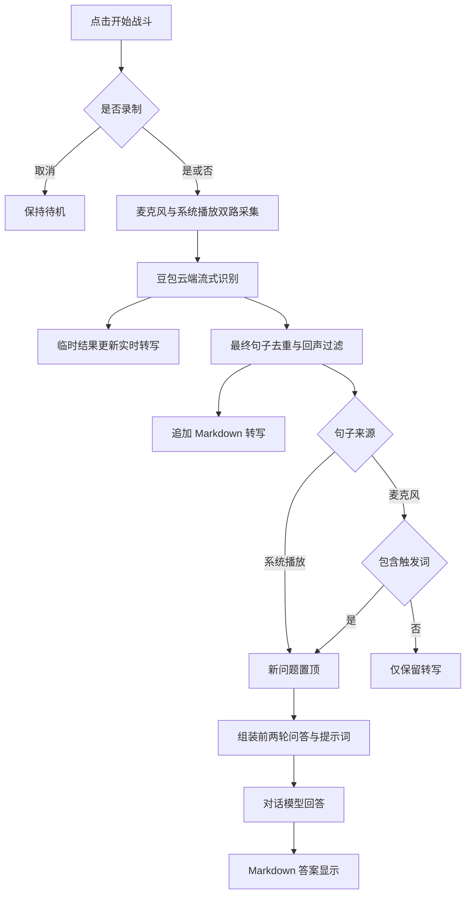
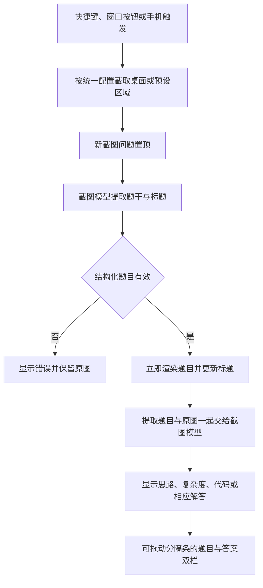

# willGo 当前版本功能说明与大版本升级基线

> 文档日期：2026-10-31。软件版本：1.10.5。
> 基线提交：`e992755a87857ed219d8adef088bdd3750c9cf97`，来自 `main`。
> 下一次大版本开发分支：`feature/next-major-update`。
> 本文描述现有代码已经实现的行为，不把历史设想或下一版需求当作现成功能。

## 1. 当前产品是什么

willGo 是一个 Windows 桌面问答助手，主要围绕技术面试、技术问答和截图解题组织交互。

用户登录后进入统一的主窗口：左侧是问题记录，右侧是当前问题的答案，底部是手动输入和实时语音转写。语音问题、截图题、手动问题和手机端提交的问题，共用这一套问题记录与答案界面。

当前可以完成的完整闭环是：

1. 听取麦克风和系统播放的声音，通过豆包云端实时识别为文字。
2. 按声音来源与触发规则决定是否自动提问，调用用户配置的对话大模型。
3. 对电脑截图先提取题目，再调用截图大模型解答，分栏显示题目和答案。
4. 阅读 Markdown 答案、代码、思路与复杂度，通过快捷键切换问题和滚动答案。
5. 按每次采集的选择，保存全程录音与文字，或仅保存文字，在历史看板查看。

### 1.1 能力总览

| 能力 | 当前效果 | 主要边界 |
| --- | --- | --- |
| 语音识别 | 麦克风、系统播放双路云端流式转写 | 需要豆包服务权限、凭证与网络 |
| 自动对话 | 对方句子自动提问；自己的句子命中触发词才提问 | 来源按音频设备区分，不按真实说话人声纹区分 |
| 上下文理解 | 对话请求携带前两轮问题与答案，支持自定义上下文提示词 | 固定为最近两个问题条目，不是长期记忆 |
| 回声去重 | 过滤扬声器回流麦克风造成的相似转写 | 文本与时间匹配，不是音频级回声消除 |
| 截图搜题 | 先提取题干，再生成答案；编程题要求思路、复杂度和代码 | 没有内置传统搜索引擎、题库命中或答案来源检索 |
| 手机操作 | 扫码打开局域网页面，触发电脑截图、提交文本或预设问题 | 手机遥控的是电脑；当前不是手机屏幕识别客户端 |
| 答案排版 | 白底黑字、标题、加粗、列表、表格、代码高亮 | 模型需输出对应内容，客户端不保证答案正确 |
| 代码阅读 | 长行自动换行，代码块完整撑高，无内部横纵滚动条 | 整个答案区仍按内容上下滚动 |
| 录音归档 | 同一会话一个双声道 WAV，配套一个 Markdown | WAV 是左右声道分轨，不是两个独立文件 |
| 历史战斗 | 按时间降序浏览记录、播放录音、打开文档 | 扫描保存目录，不是完整问答会话数据库 |
| 窗口交互 | 不透明度、鼠标穿透、全局快捷键、托盘恢复 | 快捷键冲突、显示器和会议客户端需要实际验证 |

## 2. 启动、登录与窗口生命周期

### 2.1 启动顺序

1. 检查单实例，读取当前 Windows 用户的设置。
2. 显示登录窗口。
3. 登录成功后创建主窗口、托盘图标、全局快捷键和手机访问服务。
4. 主窗口初始为待机状态，不自动启动麦克风和扬声器采集。

未登录时不能通过托盘回调、历史记录入口等跳过校验进入主界面。

### 2.2 两种登录路径

| 路径 | 当前行为 |
| --- | --- |
| 普通账号 | 进行账号长度检查，取得本机 IPv4 地址，调用既有账号校验服务；明确允许后进入 |
| 固定本地编码 | 已有专属编码入口；去除首尾空白后精确匹配，区分大小写；命中时跳过长度、IP 和服务器校验 |
| 记住账号 | 仅预填输入，不会在下次启动时自动登录 |
| 校验失败或取消 | 普通账号被拒绝、服务器不可用、退出登录窗口时，不进入主界面 |

固定本地编码的实际值见 `LoginViewModel`，本文不重复列出。该机制在客户端实现，随此版本一起分发，知道编码的人也能使用；它不会为使用者提供语音或大模型服务的 API 凭证。

### 2.3 登录页外观

- 圆角白底，绿色点缀，带晨光、窗户、台阶和纸飞机的内置图案。
- 主文案：“暂时没有回音，不代表你没有分量。”
- 辅助文案强调面试结果不能定义一个人的全部，以及准备的积累。
- 保留账号、记住账号、回车登录、错误提示和右上角退出。
- 默认尺寸为 480 × 638 个 WPF 逻辑单位；实际物理像素随系统缩放变化。
- 受屏幕工作区域限制，较小窗口通过正文滚动保证表单可访问。
- 1.10.5 已将初始宽高改为明确值，修复曾出现的原生窗口仅约 2 像素宽的问题。

### 2.4 隐藏、退出与重复打开

- 主窗口不出现在任务栏，登录后通过右下角通知区域图标恢复。
- 托盘菜单包含显示窗口、设置、切换鼠标穿透和退出。
- 关闭或隐藏主窗口通常是隐藏到后台，不等于退出程序，也不等于结束正在进行的语音采集。
- 要停止识别与录制，使用“结束战斗”；要结束软件，使用托盘“退出”。
- 再次启动软件时通知已有进程：登录阶段恢复原登录窗；已登录时恢复主界面，不创建第二个正常运行实例。

## 3. 主窗口与日常交互

### 3.1 统一工作区

当前主界面顶部显示 `willGo`，不再把“战斗模式”附加在标题里。正常启动不会创建旧版悬浮球或旧普通聊天窗口。

| 区域 | 内容与行为 |
| --- | --- |
| 顶部操作栏 | 交互状态指示、开始/结束战斗、历史战斗、截图、手机入口、取消请求、清空、设置、隐藏 |
| 左侧问题记录 | 新问题置顶，自动选中新问题；每个标题只显示一行，过长省略；显示时间、来源、状态 |
| 普通问题内容区 | 显示完整问题和生成的答案 |
| 截图问题内容区 | 在问题记录旁，进一步分为“题目”和“答案”两栏 |
| 手动输入区 | 输入文字并发送，形成新的问题条目 |
| 实时转写区 | 分别展示“我/对方”的临时转写，以及最近的最终转写记录；可以折叠 |

左侧问题列表与内容区之间的分隔条可拖动，截图题目与答案之间还有第二条独立分隔条。两处宽度分别保存。

### 3.2 手动提问

输入后点击发送图标或按回车，即可通过对话模型回答。手动提交目前按“对方问题”加入记录，并使用对话上下文机制。

`Shift+Enter` 换行；空白内容不发送；输入法选词确认不会提前提交未完成的输入。

### 3.3 问题记录与持久化的区别

问题标题、截图原图、提取题干和模型答案，当前保存在运行中的内存集合里。界面支持切换和重试，但未实现退出后恢复全部题目与答案的会话数据库。

语音 Markdown 是另外一套持久化机制：它记录语音转写，不自动等同于当前界面的完整问答历史。

## 4. 语音识别：从声音到文字

### 4.1 当前使用什么能力

当前生效的是豆包云端流式语音识别模型 2.0（小时版）的接入，代码使用 `bigmodel` 流式服务，麦克风与系统播放各建一条 WebSocket。

用户在“语音设置”填写语音接口密钥。也保留旧版应用标识与访问令牌的兼容入口，设置页提供测试连接、开通服务、创建密钥入口。

本地 ASR 模型已不参与现行运行和打包。仓库内仍有早期识别引擎、热词和术语保护源码，但当前项目文件明确将它们排除编译，不能据此判断软件仍使用本地识别。

中文、英文以及混合技术术语的识别效果取决于云端服务。客户端没有独立的英文术语校正模型，也没有“所有技术名词一定准确”的保证。

### 4.2 设备如何选取

| 声源 | 采集方式 | 界面身份 |
| --- | --- | --- |
| 麦克风 | Windows WASAPI 输入设备采集 | 我 |
| 扬声器/耳机输出 | Windows WASAPI Loopback 采集播放设备中的数字音频 | 对方 |

设备可以显式指定，也可以“跟随系统默认设备”。跟随默认时，使用每次开始采集时的 Windows 多媒体默认输入/输出设备。

采集中切换 Windows 默认设备，不会自动把现有连接热切换过去，需要结束后重新开始。设备断开、异常停止或发送失败会提示并停止当前采集，用户重新开始。

“我/对方”是按采集通道命名，不是声纹识别。同一个系统播放设备里的视频、音乐、通知声和其他人的语音，都属于系统播放来源；如果把自己的声音混到该输出里，也不能自动区分真实身份。

### 4.3 一次识别会话的操作

1. 登录后点击“开始战斗”。
2. 弹窗询问本次是否录制，默认选择为“否”。
3. 选择“是”：开启识别，保存录音和转写文档。
4. 选择“否”：仍开启识别并保存转写文档，本次不保存录音。
5. 选择“取消”：本次不开启采集。
6. 接入两路云端识别成功后，状态显示采集中，按钮变为“结束战斗”。
7. 点击“结束战斗”，关闭两路采集、收尾结果并完成会话文件。

开启前需要语音凭证、可用音频设备、网络和可写保存目录。云端连接或归档初始化失败，不应表现为已经成功开始采集。

### 4.4 临时文字与最终句子

服务不断返回临时转写，界面实时更新“我/对方”正在说的内容。临时文字可能随着后续音频被云端修正。

只有云端明确确认的最终句子，才进入正式的归档、触发判断与问题提交流程。客户端对同一条已确认云端句子做去重，避免重复处理同一最终结果。

“断句停顿”范围为 0.6 至 2.5 秒，默认 1.1 秒，它作为参数传给云端识别服务：

- 较短：通常更快结束一句，但可能把英文缩写或连续表达拆开。
- 较长：通常能保留更多连续表达，但最终结果等待时间增加。
- 这是断句参数，不是从说话到答案返回的整体延迟保证。

### 4.5 音频与网络处理

设备音频被转换为单声道 PCM，并重采样到 16 kHz、16 位后发送云端。当前实现按约 200 毫秒的音频大小组包；这不表示云端每 200 毫秒一定返回最终结果。

采集回调和网络发送分离，网络拥塞不让采集回调一直等待。队列满、网络发送失败、服务错误等会明确报告并停止采集；当前不是无限缓存，也不承诺断网时离线继续识别或自动无缝重连。

## 5. 从识别结果到大模型提问

### 5.1 自动提交规则

| 输入 | 记录转写 | 自动新建问题并回答 |
| --- | --- | --- |
| 对方最终语音句子 | 是 | 是 |
| 自己最终语音，命中触发词 | 是 | 是 |
| 自己最终语音，未命中触发词 | 是 | 否，只保留在转写中 |
| 两路临时转写 | 只作为临时显示 | 否 |
| 手动文字或手机文字 | 进入问题记录 | 是，但不是语音归档中的一条语音 |

默认麦克风触发词为“我想一想”“让我想想”“让我想一想”，可配置多个，以换行或分号分隔。

匹配时会忽略标点等非字母数字字符，按包含关系判断；它不是语义意图判断。空触发词列表不会自动变成“自己的每句话都提问”。

触发词只控制是否提交，不从问题中删除触发短语。提交给大模型的句子保留云端最终转写的原文，不再经过旧版热词替换或本地术语改写。

### 5.2 回声去重

开启扬声器外放时，对方的声音可能再次被麦克风拾取。当前默认开启“过滤扬声器回流到麦克风的重复转写”，在文字写入 Markdown 和提问分发之前处理。

1. 对方的最终结果正常及时发布。
2. 麦克风最终结果通常延迟约 1.5 秒，等待对应的对方文字。
3. 结合约 3 秒的音频时间邻域、规范化文字和保守相似度比较，识别可能的回流。
4. 同一段声音被两个设备断成不同句子时，也尝试比较相邻最多三条对方句子的组合。
5. 如果只有相似的对方临时结果而最终结果还没到，麦克风文字可能等待更久，相关等待窗口可达约 5 秒。

被判断为回流的麦克风句子，不重复进入转写归档或大模型问题。非常短的回答，以及数字、否定表达等差异，会保守处理以减少误删。

这项功能不改变保存的原始音频，不把录音中的回声消掉；也不能保证消除所有重复或完全避免误判。关闭该设置后，跨设备相似文字过滤停用，但同一云端最终结果的去重仍保留。耳机和合理的设备选择仍会影响实际结果。

### 5.3 前两轮上下文

对话请求由以下内容组成：

```text
系统：对话提示词 + 上下文提示词 + 答案排版要求
用户：前第 2 个问题
助手：该问题已有答案
用户：前第 1 个问题
助手：该问题已有答案
用户：最新问题
```

实际取的是当前问题之前的两个问题条目，按旧到新排列，可能包含之前的截图题。未触发提问的麦克风普通话语不属于这两个问答条目。

默认上下文提示词说明 Java 后端、AI 应用、Agent 岗位语境，要求根据技术逻辑合理判断识别错误。例如刚讨论 MySQL 索引时，下一句“毕加索”可能应按“B+ 树”理解。

限制和具体规则：

- 只在上下文和技术逻辑足够支持时推断，不能强行把所有后续问题关联起来。
- 前面的答案也可能有误，提示词要求不要把旧答案当成事实。
- 大模型在回答时理解或说明假设；原始转写、问题标题和历史转写文件不会因此被回写改成另一句话。
- 每个历史答案最多携带前 12,000 个字符；没有答案时携带缺失说明。
- 对话请求串行等待，尽量使下一题拿到上一题已完成的答案。
- 清空上下文提示词只去掉那段系统说明，并不会关闭代码中固定的前两轮消息传递。
- 目前没有可配置的上下文轮数、长期记忆、简历知识库或跨启动对话记忆。

### 5.4 语音主流程图



图中的 WAV 保存是音频侧并行进行的；选择不录音时，云端识别和 Markdown 仍正常工作。

## 6. 截图搜题：从画面到题目与答案

### 6.1 三种触发入口

- 全局快捷键 `Ctrl+Shift+S`。
- 主窗口截图按钮。
- 手机扫码页面上的截图操作。

三者共用“模型设置 → 截图模型 → 截图范围”，不要求语音采集正在运行。

| 截图范围 | 触发后的行为 |
| --- | --- |
| 整个桌面 | 直接截取完整桌面并提交，不弹区域选择与确认 |
| 预设区域 | 直接按已保存的矩形坐标截图并提交 |
| 预设区域未配置或无效 | 提示先在设置中选择有效区域，不自动改截其他内容 |

区域选择是设置阶段的操作：点击“选择区域”，框选并保存。后面每次快捷键截图不应再次要求框选和确认。区域保留绝对坐标，换屏、改分辨率或调整屏幕排列后需要重新检查。

### 6.2 第一阶段：提取题目

截图先以图片形式交给配置的截图模型，使用专门的提取提示词，要求只提取、不解答：

- 简短题目标题、完整题干。
- 输入输出格式、示例、约束。
- 公式、代码模板及图形的必要关系。
- 忽略导航、广告、聊天和操作按钮。
- 看不清的地方明确标注，不凭空补造条件。

模型需返回包含标题、题目 Markdown 等内容的 JSON。程序解析后，立刻更新左侧问题标题并把题目渲染出来，不必等答案完成。

当前提取步骤的系统提示词由程序专用规则控制，会覆盖截图端点中保存的普通系统提示词；用户配置的截图提示词主要在后面的解题阶段生效。

### 6.3 第二阶段：解答题目

程序将“提取后的题目 + 原始截图”一起交给截图模型解答，原图用于核对图形、公式或提取遗漏。两阶段使用同一组截图模型配置与主备切换机制，没有独立的 OCR 服务或第三套提取模型配置。

编程题的提示要求包括：

1. **解题思路**：说明核心算法、边界和必要推演。
2. **复杂度分析**：给出时间与空间复杂度。
3. **代码实现**：给出带语言标记的完整代码。

优先遵循题目给定的语言或模板，没有指定时使用 Java。非编程题直接给对应推理和答案，不强行补复杂度或代码。

这些是对模型输出的要求，不是客户端执行了编译或正确性证明。程序不运行生成的代码。

### 6.4 题目与答案的显示

- 每次截图作为一个新问题置顶，来源标为“对方 · 截图”。
- 初始显示通用截图标题，提取成功后换成简短题目标题。
- 中部左边显示题目 Markdown，右边显示解答。
- 两栏可各自上下滚动，中间分隔条可拖动，比例单独保存。
- 默认题目占内容区约 38%，保存比例范围为 25% 至 65%，实际宽度还受窗口最小布局限制。
- 原图保留在题目下方“原始截图”折叠区域，可按需展开。
- 切回语音或普通文字问题时，恢复普通答案区，不保留截图双栏占位。

### 6.5 重试、重新提取与失败

| 操作或情况 | 当前结果 |
| --- | --- |
| 重新回答 | 复用已提取题目，只重新请求解答 |
| 重新提取题目并回答 | 清除旧提取结果，从保留原图重新跑两阶段 |
| 图片中无可识别题目 | 显示错误，不继续请求解答 |
| 提取 JSON 无效或题干为空 | 报错并允许检查原图、重试 |
| 题目提取成功但解答失败 | 保留题目与原图，可重试解答 |
| 取消请求 | 停止尚在等待或执行的请求，不保证已发送请求在服务商处不计费 |

### 6.6 截图主流程图



### 6.7 “搜题”的准确含义

当前“截图搜索/搜题”是产品使用场景的叫法，实际实现为视觉模型提取与大模型解题。客户端没有主动搜索网页、查询特定题库、返回检索来源链接或逐条比对网上标准答案的流程。

一张新截图正常至少涉及“提取 + 解答”两次模型调用；失败重试和主备切换可能增加调用。截图清晰度、题干完整性、视觉模型能力、输出长度和网络共同决定体验，不能承诺固定响应秒数或所有题目一次答对。

## 7. 大模型配置、调度与答案生成

### 7.1 两套独立路由

| 配置 | 处理内容 | 必要能力 |
| --- | --- | --- |
| 对话模型 | 语音触发、手动文字、手机文字与预设问题 | 文本问答，能理解传入上下文 |
| 截图模型 | 截图题目提取与解答 | 对当前接口协议可用的图片理解能力 |

两套各有主模型、备用模型与首选选择。每个端点包含名称、协议、接口地址、密钥、模型标识、超时与重试参数。

支持自动协议选择、OpenAI Chat Completions、OpenAI Responses 和 Anthropic Messages 接口形式。这里指协议兼容能力，不表示只能使用这些公司的托管模型；实际能否使用取决于配置的服务端是否兼容。

对话的系统提示词由“语音设置”的对话提示词、上下文提示词与程序排版要求组装；截图解答使用截图端点提示词，并追加解题与排版要求。

### 7.2 调度与失败处理

- 优先请求选中的端点，按可重试错误和次数参数重试，再切备用端点。
- 主备均失败时显示请求失败原因，保留问题供重试。
- 当前 `MaxRetries` 在路由实现中按最多尝试次数使用，至少一次，并非“一次初始请求再额外重试 N 次”。
- 问答处理全局并发上限为 2；普通对话还有串行限制，以保留前轮答案上下文。
- 待处理任务达到 20 个时，新问题可显示队列已满，需要后续手动重试。
- 目前主界面在拿到完整 `ModelReply` 后赋值答案，不是逐 token 流式显示大模型回答；语音转写的实时更新不等于答案也在流式输出。

取消请求与结束语音是不同操作。取消模型请求不会自动结束采集；清空问题会清掉当前界面问题与转写显示，但不会自动删除磁盘里的历史归档。

## 8. 答案排版与代码显示

### 8.1 普通答案

当前为白底深色字，正文默认 18，设置和答案工具栏可在 14 至 28 之间调整。正文有约 1.75 倍行高和段落间隔。

支持 Markdown 标题、少量重点加粗、列表、行内代码、代码块、引用和表格。程序还会向模型追加排版要求，但不会强行把任意纯文字答案改成完整的分节结构。

### 8.2 代码块

- 使用 AvalonEdit 渲染，支持只读选择、行号、语言高亮和复制。
- 支持常见 Java、C#、C/C++、Python、JavaScript/TypeScript、JSON、SQL、XML/HTML 等语言映射；未知语言按普通代码显示。
- 长行按当前可见宽度自动换行，调整窗口、分隔条或字号时重新排版。
- 取消旧版 600 像素高度上限，代码块随完整内容撑高。
- 代码内部没有横向和纵向滚动条；通过整个答案区的上下滚动查看长内容。
- 鼠标放在代码上滚轮，滚动的是外层阅读区。
- 换行仅影响显示，复制仍保留原始代码内容、缩进和实际换行，不插入界面自动换出的新行。
- 截图题目里提取出的代码模板，也使用同样的渲染方式。

“完整展开”不表示任意长度代码能同时塞进一屏，而是没有被代码框截断，不需要进入代码框内部左右或上下滚动。

## 9. 录音与文字归档

### 9.1 保存结果

| 本次选择 | WAV | Markdown |
| --- | --- | --- |
| 是，录制 | 一个完整会话录音 | 一个对应的完整语音转写文档 |
| 否，不录制 | 不生成 | 仍生成 |
| 取消 | 不开启本次会话 | 不开启本次会话 |

默认目录为当前 Windows 用户文档目录下的 `willGo/Recordings`，可在语音设置中选择其他绝对路径。目录必须可创建、可写入。

同一会话采用同一基础名称，例如：

```text
willGo-20261031143005.wav
willGo-20261031143005.md
```

名称中的时间为本地“年月日时分秒”；重名时追加 `-2`、`-3` 等后缀。仅保存文字时也使用同样规则。

### 9.2 一个文件包含两路录音

WAV 为 16 kHz、16 位、双声道 PCM：左声道为麦克风，右声道为系统播放。两路保存在一个可正常播放的 WAV 中，同时保持通道区分和静音时间，不是把两路强制混成一个单声道。

录音来自同一次采集，不需要分别开启额外的录音设备。连续保存约每分钟 3.84 MB、每小时 230 MB，实际大小随时长变化。当前经典 WAV 大小限制对应单次约 18 小时，不支持无限长会话文件。

### 9.3 Markdown 格式

文档含会话开始时间、录音链接或“仅保存文字”的说明，以及逐条追加的最终转写，结束时写结束时间和会话时长。示意：

```markdown
# willGo 语音记录

开始时间：2026-10-31 14:30:05 +08:00

音频：[willGo-20261031143005.wav](./willGo-20261031143005.wav)

---

### 14:30:10.120 对方：

请解释一下 MySQL 的索引结构。

### 14:30:16.450 我：

我想一想，为什么 B+ 树适合数据库索引？
```

两路身份会分别标注，但不强制“我、对方”严格交替。文件按通过过滤后的结果到达顺序追加，麦克风延迟过滤和云端回包可能造成跨设备时间戳并非严格递增。

当前 Markdown 不自动包含大模型答案、截图图片、提取题干、手动问题或手机文字问题。它是语音转写归档，不是完整问答报告。界面实时转写区仅保留最近 300 行记录，磁盘归档则持续追加本次识别结果。

## 10. 历史战斗看板

点击主界面的“历史战斗”，读取当前配置的归档目录。

- 只扫描该目录顶层的 WAV 和 Markdown，以相同文件基础名配对为一次会话。
- 显示记录名、开始时间、录音是否存在、文档是否存在、是否正在写入或被占用。
- 按时间降序排列；仅有文档或仅有录音的条目也会出现。
- 时间优先从标准文件名解析，不符合已知命名时使用相应文件的最后修改时间。
- 可直接播放、暂停、停止、拖动进度、调节音量，也可调用系统应用打开文档或目录。
- 刷新后重新扫描；切换设置里的目录后，历史看板读取新的目录，不自动合并旧目录。
- 采集进行时暂停或禁止历史录音播放，防止播放的历史声音再次被识别。
- 当前看板不提供内置问答报告编辑、转写重识别、全文检索、云同步或会话数据库迁移。

## 11. 手机扫码与快捷提问

登录成功后，程序启动局域网 HTTP 服务，默认尝试端口 38647，被占用时尝试后续最多 10 个候选端口。手机入口展示可用地址和二维码。

手机与电脑通常需处于同一可互通局域网，且电脑防火墙允许相应端口访问。二维码对应电脑当前地址，不是互联网云端账号页面。

手机页面可以：

1. 触发电脑按已配置范围截图并提交。
2. 输入文字问题并发送到电脑主窗口。
3. 点击预设问题，发送预先保存的完整提问。

预设问题可在“快捷提问”中添加、编辑、启用/禁用、调整顺序和删除，手机页面只展示启用的有效条目。

当前移动端没有独立的语音采集、手机截图上传与历史问答同步流程。局域网服务没有独立的手机账号登录或配对鉴权，也不是 HTTPS 服务；知道地址且网络可达的设备可以请求该入口，属于可信局域网内的遥控能力。

## 12. 全局快捷键与窗口显示

### 12.1 快捷键总表

| 快捷键 | 当前作用 |
| --- | --- |
| `Ctrl+1` | 切换鼠标穿透与可交互状态，作用覆盖主窗口及附属应用窗口 |
| `Ctrl+Shift+S` | 按保存范围截图并加入新问题 |
| `Ctrl+Shift+↑` | 选中左侧相邻的更新问题 |
| `Ctrl+Shift+↓` | 选中左侧相邻的更早问题 |
| `Ctrl+↑` | 向上滚动当前可见答案区 |
| `Ctrl+↓` | 向下滚动当前可见答案区 |
| `Ctrl+Shift+←` | 降低窗口不透明度，每步约 5 个百分点 |
| `Ctrl+Shift+→` | 提高窗口不透明度，每步约 5 个百分点 |
| `Enter` | 输入框中发送；登录窗中提交登录 |
| `Shift+Enter` | 主窗口手动输入框内换行 |
| 分隔条获得焦点后 `←/→` | 键盘调整分隔条宽度 |
| 设置窗口 `Esc` | 取消本次设置编辑 |

全局功能在登录后初始化。截图和不透明度组合键有部分占用回退处理，但不代表全部快捷键在所有桌面环境中都能避免冲突；注册失败应按状态提示处理。

### 12.2 鼠标穿透

顶部状态指示为灰黑色时，窗口可正常点击；为白色时，鼠标操作穿过窗口，交给下面的应用，不应因悬浮窗内容而出现文本光标或拖动手柄等样式。

白色状态可继续用全局快捷键调节阅读内容、透明度等，再按 `Ctrl+1` 恢复交互。鼠标穿透与透明度是两种独立能力，调低透明度不会自动开启穿透。

### 12.3 不透明度与共享隐藏

窗口不透明度范围为 30% 至 100%，100% 是实白底，低于 100% 透出后面的桌面。当前界面基色始终是白色，并不是调到最高时换成黑底。

“在截图与屏幕共享中隐藏窗口”默认开启，使用 Windows 的捕获排除能力，要求相应 Windows 版本及捕获方式支持。本机显示与捕获结果属于不同层面。

应用还通过原生工具窗口属性减少任务栏与部分窗口选择器中的出现。不过共享画面不包含窗口，不等于所有会议软件的共享候选列表都一定不列出窗口名称，也不等于进程不可见。不能把这一项描述为“任何共享软件都绝对检测不到”。

## 13. 设置项分组与建议起点

设置页共有五个一级栏目：

| 栏目 | 当前内容 |
| --- | --- |
| 使用说明 | 快捷键、主要流程、设置用途、保存与取消规则 |
| 模型设置 | 截图/对话两组主备模型、协议、地址、密钥、超时、尝试次数；截图范围与区域选择 |
| 语音设置 | 豆包凭证、测试连接、设备、保存目录、断句停顿、回声过滤、对话提示词、上下文提示词、麦克风触发词 |
| 快捷提问 | 手机预设问题的名称、内容、启用状态与顺序 |
| 界面设置 | 捕获隐藏、窗口不透明度、答案字号 |

建议初始设置：设备先跟随系统默认；断句先保持 1.1 秒；字号先用 18 至 20；阅读时不透明度用 90% 至 100%；回声过滤保持开启；先测试清晰的简单截图，再测试复杂题目。

这些建议不代替具体设备和服务测试。模型标识、接口和凭证由使用者配置，源码里的默认模型名不代表当前用户实际正在使用的商业模型。

保存设置后应用修改；取消或 Esc 放弃这次编辑；恢复默认先改变编辑内容，再保存才生效。恢复默认会影响自定义提示词和凭证，应在清楚影响时使用。

## 14. 本地数据、分发与费用边界

### 14.1 设置与凭证

- 当前用户设置位于 `%LOCALAPPDATA%/FloatingDeskAssistant/appsettings.user.json`。
- Windows 下语音与模型密钥使用当前用户范围的 DPAPI 保护，迁移到重装系统或另一用户时可能需要重新填写。
- 接口地址、模型名、提示词、设备标识等属于本地设置；不要把“密钥受保护”理解为整个设置文件所有字段都加密。
- 正常分发安装包不包含当前用户的设置和录音目录，给他人使用时应发送构建出的安装包，而不是整个个人数据目录。

### 14.2 数据发往哪里

| 数据 | 当前流向 |
| --- | --- |
| 两路采集音频 | 发送到配置接入的豆包云端识别服务 |
| 已提交的语音/文字问题与前两轮问答 | 发送到配置的对话模型提供方 |
| 截图、提取题目 | 发送到配置的截图模型提供方，提取和解答两个阶段都可能发送图片 |
| WAV 与 Markdown | 保存在本地设置目录指定的位置 |

选择“不录音”只是不保存本地 WAV，不会让云端识别停止上传音频。普通登录需要网络；固定本地编码只放行客户端，不会让语音或大模型服务离线运行。

### 14.3 费用与安装包

豆包语音和问答大模型是不同的服务与计费来源。两路语音分别建立连接，实际费用应按服务商计费规则核实，不应默认“一小时采集只产生一路识别费用”。截图至少两阶段调用，也有独立模型消耗。

当前不打包大型本地 ASR 模型。Windows 自包含安装包仍包含应用、运行时和依赖，不能描述为“只剩几 MB”；实际文件大小以构建产物为准。

## 15. 当前尚未实现或不能保证的效果

| 项目 | 当前边界 |
| --- | --- |
| 本地离线语音识别 | 不在当前运行路径中 |
| 识别结果百分之百准确 | 不能保证，尤其缩写、口音、重叠说话与噪声 |
| 音频级自动回声消除 | 当前只有转写层过滤，不净化录音波形 |
| 真实人物说话人分离 | 按采集设备归类，不做声纹识别 |
| 完整问答持久化 | 问答与截图条目是内存状态，归档主要是语音 |
| 传统联网搜题、来源引用 | 客户端未实现独立检索链路 |
| 大模型答案流式输出 | 当前完整答复后显示 |
| 自动编译和运行生成代码 | 未实现，也不会执行答案代码 |
| 自定义上下文轮数 | 当前固定最近两条问题，不能在界面调轮数 |
| 无缝切换设备或断网重连 | 需要停止并重新开始采集 |
| 无限长录音、压缩录音格式 | 当前为有大小上限的 PCM WAV |
| 任何共享候选列表都不出现 | 依赖 Windows 和会议软件，不能保证 |
| 手机端独立识别与完整会话同步 | 当前是局域网遥控入口 |

## 16. 关键实现位置

以下路径均相对于仓库根目录，用于下一版改造时定位责任范围。

| 模块 | 关键文件 |
| --- | --- |
| 启动、认证门禁、单实例恢复、窗口与服务装配 | `src/FloatingDeskAssistant/App.xaml.cs` |
| 登录判断与界面 | `ViewModels/LoginViewModel.cs`、`UI/Windows/LoginWindow.xaml` 及其后台代码 |
| 问题条目、触发词、提示词与上下文、请求调度 | `ViewModels/BattleViewModel.cs` 中的 `BattleEntry`、`BattlePrompt`、`BattleViewModel` |
| 双设备采集、网络发送、归档与结果分发 | `Application/BattleSpeechService.cs` |
| 豆包协议、双路客户端、临时与最终结果解析 | `Application/DoubaoSpeechClient.cs` |
| 回流转写过滤 | `Application/SpeechEchoFilter.cs` |
| 截图采集与两阶段题目提示 | `Application/ScreenshotService.cs`、`Application/ScreenshotQuestion.cs` |
| 主备模型与接口协议实现 | `Application/ModelRouter.cs`、`Infrastructure/Api/OpenAiModelClient.cs` |
| 主界面、输入发送、独立分隔条 | `UI/Windows/BattleWindow.xaml` 及其后台代码 |
| Markdown 与完整自动换行代码块 | `UI/Controls/AnswerContentPresenter.cs`、`UI/Controls/CodeBlockView.cs` |
| WAV 与 Markdown | `Application/SpeechSessionArchive.cs` |
| 历史扫描、播放与界面 | `Application/BattleHistory.cs`、`Application/HistoryAudioPlayer.cs`、`ViewModels/BattleHistoryViewModel.cs`、`UI/Windows/BattleHistoryWindow.xaml` |
| 手机访问与预设问题 | `Application/RemoteCaptureServer.cs`、`ViewModels/MainViewModel.cs` |
| 快捷键、穿透、捕获排除、托盘 | `Application/GlobalInteractionHotkeys.cs`、`GlobalOpacityHotkeys.cs`、`WindowInteraction.cs`、`WindowCaptureProtection.cs`、`TrayIconService.cs` |
| 配置保存与密钥保护 | `Configuration/`、`Infrastructure/Config/AppConfigService.cs`、`Infrastructure/Security/ApiKeyProtector.cs` |
| 设置编辑界面 | `UI/Windows/SettingsWindow.xaml`、`ViewModels/SettingsViewModel.cs` |

除第一行和配置路径外，表中省略的统一前缀为 `src/FloatingDeskAssistant/`。

## 17. 下一次大版本的对照验收清单

这是一份现有效果的回归基线，不预设下一版具体实现方案。用户后续给出大版本需求后，再决定哪些保留、替换或移除。

| 编号 | 场景 | 当前应观察到的结果 |
| --- | --- | --- |
| L01 | 新启动，未登录 | 先出现可见且尺寸正常的登录窗口，主功能未开放 |
| L02 | 普通账号失败/成功 | 失败留在登录页，成功才进入主界面 |
| L03 | 本地编码登录 | 按精确规则直接进入，不调用服务器校验 |
| L04 | 再次启动同一应用 | 恢复已有登录窗或主窗，只有一个运行实例 |
| A01 | 开始战斗选择“是” | 双路识别，有一份 WAV 和同名 Markdown |
| A02 | 开始战斗选择“否” | 双路识别，只有 Markdown |
| A03 | 选择“取消” | 不开始本次采集 |
| A04 | 系统播放一句明确问题 | 最终句子形成一个新问题，置顶并回答 |
| A05 | 麦克风普通说话 | 有转写，不自动生成问题 |
| A06 | 麦克风命中触发词 | 原文形成问题，不做旧版术语替换 |
| A07 | 外放声音再次被麦克风拾取 | 满足匹配规则的回流不重复记文档或提问 |
| A08 | 默认设备变化 | 重启采集后使用新默认设备 |
| C01 | 连续两个相关问题再问第三题 | 对话模型收到前两条问题和答案作为上下文 |
| C02 | 歧义技术名词 | 模型结合上下文回答，原始转写不被回写覆盖 |
| S01 | 已保存区域后按截图快捷键 | 直接截取并提交，不再弹框选或确认 |
| S02 | 截图识别题目 | 先看到提取题目，随后看到答案 |
| S03 | 编程题 | 有思路、复杂度、语言代码块；程序不执行代码 |
| S04 | 重试与重新提取 | 前者复用题干，后者重跑提取与解答 |
| U01 | 窄窗口、长代码、较大字号 | 自动换行、完整撑高、无代码内部横纵滚动条 |
| U02 | 复制自动换行代码 | 得到原文，不带界面人为增加的换行 |
| U03 | 两处拖动分隔条 | 独立调整并保存，切题后布局正确 |
| U04 | 快捷键切题、滚动和透明度 | 分别操作对应对象，不串用旧快捷键 |
| U05 | 鼠标穿透 | 顶部指示改变，点击交给下层，全局快捷键可恢复 |
| H01 | 历史包含仅文字和音文配对 | 降序展示，文件状态正确，能打开与播放 |
| H02 | 采集中请求历史播放 | 阻止或停止播放，避免历史音频进入识别 |
| P01 | 手机触发截图、文字、预设问题 | 问题与答案出现在电脑统一主界面 |
| D01 | 重启应用 | 用户设置保留；不应把内存题目列表误认为完整持久化 |

## 18. 本文核验范围

本次以基线提交的源码、配置默认值、界面定义和仓库内测试用例为依据，核对当前功能与边界。历史发布记录可以作为补充，但旧说明与当前代码冲突时，以当前代码为准。

当前电脑是重装后的开发环境，本次工作是分支准备与文档整理，没有重新编译应用、调用真实豆包/问答 API、重新打包安装或逐款会议软件验收。仓库中的测试用例存在，不代表已在这台新环境重新运行并通过。

下一次大版本的功能范围、版本号、模型替换、界面重构或数据迁移方案，等待后续需求确定。
